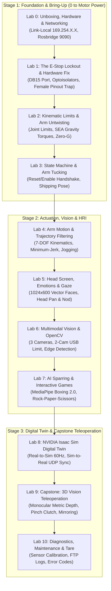

# 🎓 Baxter Robot Teaching Labs & Engineering Curriculum

[](LABS.md)
[](docs/reference/hardware_specifications.md)
[](pyproject.toml)
[](LICENSE)

Welcome to the **Baxter Research Robot Teaching Labs & Engineering Curriculum**. 

This comprehensive laboratory course guides students, researchers, and robotics engineers step-by-step from unboxing, physical power, and the notorious **E-Stop hardware interlock fix**, up through 7-DOF kinematics, multimodal computer vision, interactive AI gaming, NVIDIA Isaac Sim digital twins, and a capstone **3D Monocular Spatial Vision Teleoperation System**.

---

## 📋 Curriculum Roadmap & Lab Directory



---

## 🔬 Lab Syllabus Quick Reference

| # | Lab Title | Primary Focus | Key Skills & Hardware Involved | Dedicated Guide |
| :-: | :--- | :--- | :--- | :-: |
| **0** | **[Prerequisites & Network Setup](docs/labs/00_prerequisites_and_hardware.md)** | Getting to Ping | AC Power, Link-Local IPv4, Rosbridge WebSockets, Modern Python 3 | [📖 Read Lab 0](docs/labs/00_prerequisites_and_hardware.md) |
| **1** | **[The E-Stop Lockout & Hardware Fix](docs/labs/01_estop_and_safety_hardware_fix.md)** | Power Interlock | DB15 Port, Optoisolated 24V Loop, Female Pinout Trap, Safety Bypass | [📖 Read Lab 1](docs/labs/01_estop_and_safety_hardware_fix.md) |
| **2** | **[Kinematic Limits & Arm Untwisting](docs/labs/02_kinematics_limits_and_arm_untwisting.md)** | Joint Clearing | `e0`/`w0` Twist Limits, `e1` Hyperextension, SEA Torques, Zero-G Mode | [📖 Read Lab 2](docs/labs/02_kinematics_limits_and_arm_untwisting.md) |
| **3** | **[Initialization & Arm Tucking](docs/labs/03_robot_initialization_and_state_machine.md)** | State Machine | Reset/Enable Handshake, Shipping Pose Tuck/Untuck, Collision Override | [📖 Read Lab 3](docs/labs/03_robot_initialization_and_state_machine.md) |
| **4** | **[Arm Control & Trajectory Filtering](docs/labs/04_arm_control_and_trajectory_filtering.md)** | Motion Control | 7-DOF Limb Actuation, Low-Pass Filtering, Joint Jogging, Poses | [📖 Read Lab 4](docs/labs/04_arm_control_and_trajectory_filtering.md) |
| **5** | **[Head Display, Emotions & Gaze](docs/labs/05_screen_display_and_head_interaction.md)** | Social Robotics | 1024x600 LCD Screen, Vector Emotions, Custom Banners, Head Pan & Nod | [📖 Read Lab 5](docs/labs/05_screen_display_and_head_interaction.md) |
| **6** | **[Multimodal Vision & OpenCV](docs/labs/06_vision_and_camera_pipeline.md)** | Computer Vision | 3 CMOS Cameras, 2-Cam USB Limit, Resolution Modes, OpenCV Pipeline | [📖 Read Lab 6](docs/labs/06_vision_and_camera_pipeline.md) |
| **7** | **[AI Gesture Recognition & HRI](docs/labs/07_interactive_ai_gaming_and_hri.md)** | Interactive AI | Google MediaPipe, Reflex Boxing 2.0, Rock-Paper-Scissors, Dance | [📖 Read Lab 7](docs/labs/07_interactive_ai_gaming_and_hri.md) |
| **8** | **[NVIDIA Isaac Sim Digital Twin](docs/labs/08_digital_twin_and_isaac_sim.md)** | Simulation | Real-to-Sim 60Hz Telemetry, Sim-to-Real UDP Commanding, RTX Renders | [📖 Read Lab 8](docs/labs/08_digital_twin_and_isaac_sim.md) |
| **9** | **[Capstone: 3D Vision Teleoperation](docs/labs/09_capstone_3d_spatial_vision_teleoperation.md)** | Capstone Project| Monocular 3D Metric $(X,Y,Z)$, Pinch Clutch, Isometric HUD, Dual-Arm Teleop | [📖 Read Lab 9](docs/labs/09_capstone_3d_spatial_vision_teleoperation.md) |
| **10**| **[Diagnostics, Maintenance & Tare](docs/labs/10_hardware_diagnostics_and_maintenance.md)** | Maintenance | Sensor Tare, Zero-G Rubber Calibration, FTP `/var/log`, Error Dictionary | [📖 Read Lab 10](docs/labs/10_hardware_diagnostics_and_maintenance.md) |

---

## 🛠️ Detailed Lab Summaries & Engineering Notes

### [Lab 0: Prerequisites, Physical Architecture & Network Setup](docs/labs/00_prerequisites_and_hardware.md)
* **Hardware Overview**: 15 active DOFs (14 arm + 1 head pan), 12-sensor sonar ring, 3 CMOS cameras, onboard x86 Ubuntu PC.
* **Power Connection**: 100–240 VAC universal supply; rear main rocker switch.
* **Link-Local Networking**: Baxter auto-assigns an IPv4 address on the `169.254.X.X` subnet. Connect via Ethernet and discover Baxter's IP using `arp-scan` or `avahi-browse`.
* **Rosbridge WebSockets**: Port 9090 provides direct JSON-based ROS communication, allowing modern Ubuntu 22.04/24.04 and Python 3.10+ workstations to interact without legacy ROS 1 or Python 2.

---

### [Lab 1: The E-Stop Hardware Lockout & The Real-World Fix](docs/labs/01_estop_and_safety_hardware_fix.md)
* **The Missing E-Stop Mystery**: Baxter has NO physical E-stop button on its body. Powering on results in `estop_button: 1`, `estop_source: 4` (`SEA_GLOBAL_ERROR_NO_EXTERNAL_ENABLE`).
* **The Optoisolator Trap**: The rear DB15 safety port uses optocoupled LEDs. Shorting Pin 4 to Pin 12 with a paperclip fails because optocouplers require active current ($5\text{V} \dots 24\text{V DC}$) to conduct.
* **The Female D-Sub Mirror-Image Trap**: Looking into the female holes on Baxter's rear waist, **Pin 1 is in the TOP-RIGHT corner** (not top-left!), and **Pin 9 is in the BOTTOM-RIGHT corner**. Counting left-to-right leads to miswiring Pin 8 and Pin 15!
* **Wiring Fixes**:
  - **Option 1 (Mushroom Safety Pendant)**: Pin 1 (+24V) $\rightarrow$ E-Stop Switch $\rightarrow$ Pin 4 (`Torso In 0`); Pin 12 (`Torso Return`) $\rightarrow$ Pin 9 (`GND`).
  - **Option 2 (Benchtop Bypass Plug)**: Jumper Pin 1 to Pin 4; Jumper Pin 12 to Pin 9.
  - *CAUTION*: Never short Pin 4 to Pin 12 while connected to Pin 1 and 9 (direct +24V to GND short!).

---

### [Lab 2: Kinematic Limit Traps, SEA Gravity Faults & Safe Arm Untwisting](docs/labs/02_kinematics_limits_and_arm_untwisting.md)
* **The Twist Joint Trap**: Joints `e0` (upper arm roll) and `w0` (forearm roll) have limits of $\pm 175^\circ$. When moved while unpowered, arms frequently twist against internal mechanical hard stops (~$-174^\circ$), tripping kinematic limit watchdogs.
* **Elbow Hyperextension**: Elbow hinge `e1` locking backwards ($-3.6^\circ$) blocks motor power.
* **Series Elastic Actuator (SEA) Torque Trips**: Limbs outstretched horizontally exert maximum cantilevered gravity torques on unpowered torsion springs.
* **Manual Untwisting Routine**:
  1. Flex elbow `e1` forward into an L-shape ($45^\circ \dots 90^\circ$).
  2. Rotate forearm `w0` so cuff buttons face upright/forward ($0^\circ$).
  3. Support wrist slightly during `baxter enable` to relieve spring gravity torque.
  4. Use the soft rubber cuff ring (Zero-G mode) for effortless manual positioning.

---

### [Lab 3: Robot Initialization, State Machine & Arm Tucking](docs/labs/03_robot_initialization_and_state_machine.md)
* **State Machine Transitions**: `DISABLED` $\rightarrow$ `RESETTING` $\rightarrow$ `ENABLED` / `STOPPED`.
* **The 3-Step Handshake**: `enable(True)` alone fails if errors are latched. You must pulse Disable (`/robot/set_super_enable: False`), pulse Reset (`/robot/set_super_reset`), wait 300 ms, then pulse Enable (`/robot/set_super_enable: True`).
* **Shipping Pose Tucking & Untucking**:
  - `baxter untuck`: Expands arms from compact storage into operational neutral stance.
  - `baxter tuck`: Folds arms back into torso for transport.
  - *Collision Avoidance Suppression*: Heartbeat pulses sent to `/robot/limb/<side>/suppress_collision_avoidance` allow tightly-packed arm unfolding without collision halts.

---

### [Lab 4: Arm Control, Joint Jogging & Trajectory Filtering](docs/labs/04_arm_control_and_trajectory_filtering.md)
* **SEA Spring Resonance**: Commanding sudden step setpoints excites Baxter's joint torsion springs, causing severe mechanical shuddering ($2 \dots 5\text{ Hz}$).
* **Trajectory Filtering**: First-order low-pass filters and minimum-jerk (quintic polynomial) smoothing ensure velvet-smooth, stable arm trajectories.
* **Joint Jogging CLI**: `baxter jog <left|right> <joint> <delta_deg>` for fast calibration and joint positioning.
* **Predefined Poses**: Built-in choreographies (`wave`, `cheer`, `salute`, `reach`, `neutral`).

---

### [Lab 5: Head Screen Display, Facial Emotions & Gaze Control](docs/labs/05_screen_display_and_head_interaction.md)
* **Head LCD Pipeline**: 1024x600 color LCD receiving raw RGB8/BGR8 images via `/robot/xdisplay`.
* **Vector Facial Expressions**: Real-time procedural rendering of expressive cartoon faces (`happy`, `focused`, `wink`, `boxing`, `disco`, `sleepy`, `surprised`).
* **Custom Overlays**: Display arbitrary PNG/JPEG images or real-time status banners across Baxter's forehead and chin.
* **Head Pan & Nod**: Actuate 1-DOF yaw pan ($\pm 90^\circ$) and trigger affirmative nodding cycles.

---

### [Lab 6: Multimodal Vision, Embedded Cameras & OpenCV Pipeline](docs/labs/06_vision_and_camera_pipeline.md)
* **Camera Architecture**: 3 Omnivision 1.2 MP CMOS sensors (`head_camera`, `left_hand_camera`, `right_hand_camera`).
* **The 2-Camera USB Bandwidth Limit**: Baxter's internal USB 2.0 bus supports **at most TWO cameras streaming concurrently**. Opening a third camera crashes the driver unless an idle camera is closed first.
* **Resolution Switching**: Modes from 320x200 @ 25fps up to 1280x800 @ 30fps.
* **OpenCV Integration**: Asynchronously decoding frames into NumPy arrays for real-time edge detection, contour mapping, and visual servoing.

---

### [Lab 7: AI Gesture Recognition & Interactive HRI Games](docs/labs/07_interactive_ai_gaming_and_hri.md)
* **MediaPipe AI Integration**: 21 3D hand keypoints extracted in under 25 ms.
* **Reflex Boxer 2.0 (`baxter box`)**: Closed-loop reactive sparring partner responding to human jabs, parries, and dodges.
* **Interactive Arena (`baxter play`)**: Rock-Paper-Scissors tournament with robotic countdown, Jedi shadow teleoperation, and fist-bump contact sensing via SEA spring deflection.
* **Choreographies**: 124 BPM musical dance party (`baxter dance`) and 5-act classical orchestral symphony (`baxter symphony`).

---

### [Lab 8: NVIDIA Isaac Sim Digital Twin & Bidirectional Telemetry](docs/labs/08_digital_twin_and_isaac_sim.md)
* **Digital Twin Architecture**: Articulated Baxter USD model in NVIDIA Omniverse Isaac Sim.
* **Real-to-Sim Telemetry**: Physical joint encoder telemetry streamed to the simulator at 60+ FPS.
* **Sim-to-Real Control**: Keyboard teleoperation inside Isaac Sim mirrored onto physical Baxter hardware via UDP (`127.0.0.1:19888`).
* **Photorealistic RTX Renders**: Instant ray-traced viewport snapshots with ground-truth contact physics.

---

### [Lab 9: Capstone: 3D Spatial Vision Teleoperation & Fingertip Tracking](docs/labs/09_capstone_3d_spatial_vision_teleoperation.md)
* **Monocular 3D Reconstruction**: Computing metric $(X, Y, Z)$ coordinates in meters from a standard 2D web camera using perspective projection and known human anatomical knuckle span ($W_{\text{phys}} \approx 8.5\text{ cm}$).
* **Isometric 3D HUD**: Floating visualizer rendering spatial bounding volumes and real-time motion trails.
* **Pinch Clutch**: Pinching thumb and index engages teleoperation; releasing allows free hand repositioning without moving the robot.
* **Sim-to-Real Teleop**: Concurrent streaming to physical motors and Isaac Sim digital twin.

---

### [Lab 10: Hardware Diagnostics, Maintenance & Log Retrieval](docs/labs/10_hardware_diagnostics_and_maintenance.md)
* **Tare & Calibration**: Weekly spring bias tare and monthly 14-joint kinematic recalibration.
* **Zero-G Rubber Cuff Calibration**: Diagnostic testing of wrist squeeze sensors.
* **FTP Log Extraction**: Retrieving `/var/log/rethink.log` directly over FTP (port 21).
* **Error Code Dictionary**: Comprehensive reference of all `baxter_core_msgs` faults and recovery steps.

---

## 📚 Archived Reference Documentation

Deep technical reference documents archived directly from the Rethink Robotics SDK Wiki:
- 📖 **[Hardware Specifications Reference](docs/reference/hardware_specifications.md)**: Full physical dimensions, torques, electrical power, and component layout.
- 📖 **[DB15 Safety & User I/O Pinout Reference](docs/reference/db15_user_io_pinout.md)**: Complete pinout, optical isolation specs, and wiring diagrams.
- 📖 **[ROS Topics, Services & Messages Reference](docs/reference/ros_topics_and_messages.md)**: Complete topic dictionary, service definitions, and message schemas.
- 📖 **[Kinematics & DH Parameters Reference](docs/reference/kinematics_and_dh_parameters.md)**: Modified Denavit-Hartenberg parameters, transformations, and SEA compliance equations.

---

## 🚀 Quickstart: Running Your First Baxter Lab

```bash
# 1. Clone repository and install modern Python 3 package
git clone https://github.com/RoboX2020/baxter-py.git
cd baxter-py
pip install -e ".[vision]"

# 2. Check system status (verify E-Stop from Lab 1 is cleared)
baxter status

# 3. Energize motors and untuck arms into operational posture
baxter enable
baxter untuck

# 4. Display greeting emotion on head screen
baxter face happy --text "BAXTER LAB READY!"

# 5. Launch interactive AI sparring partner or 3D vision teleoperation
baxter box
# or
baxter track
```
