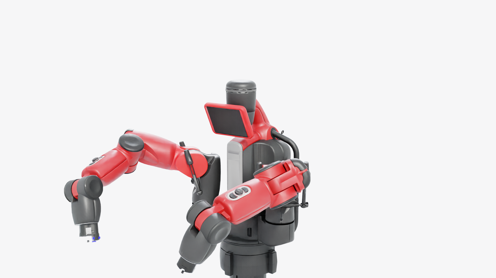
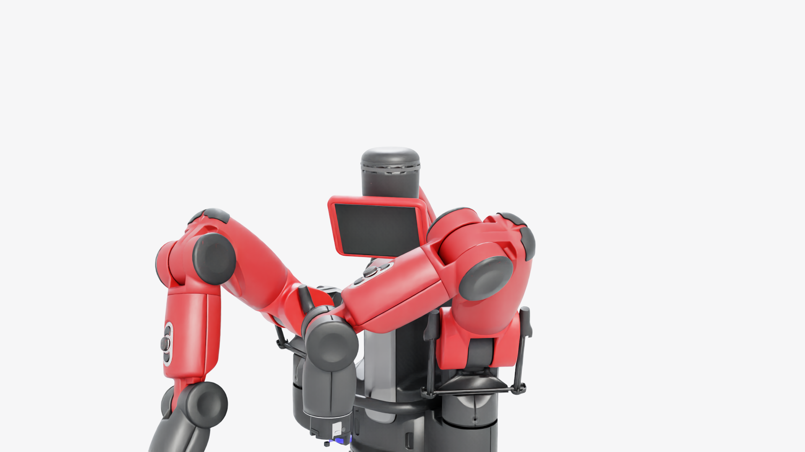
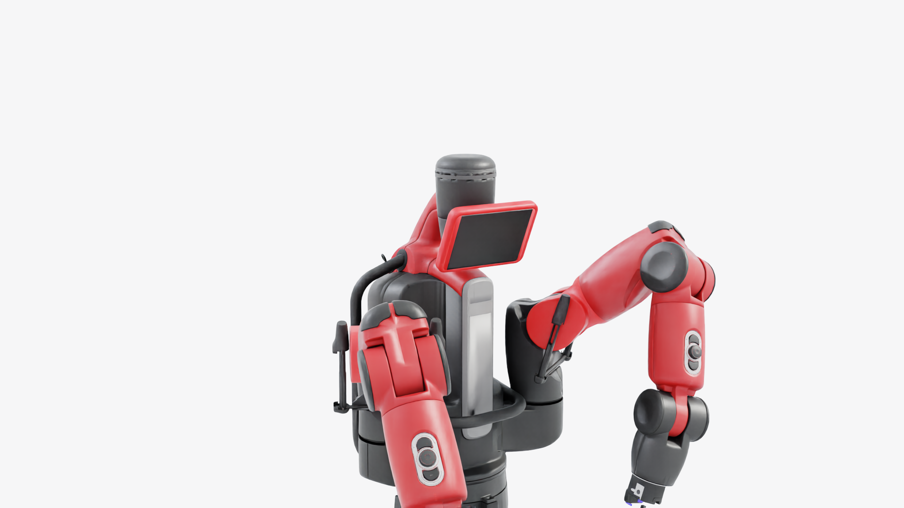
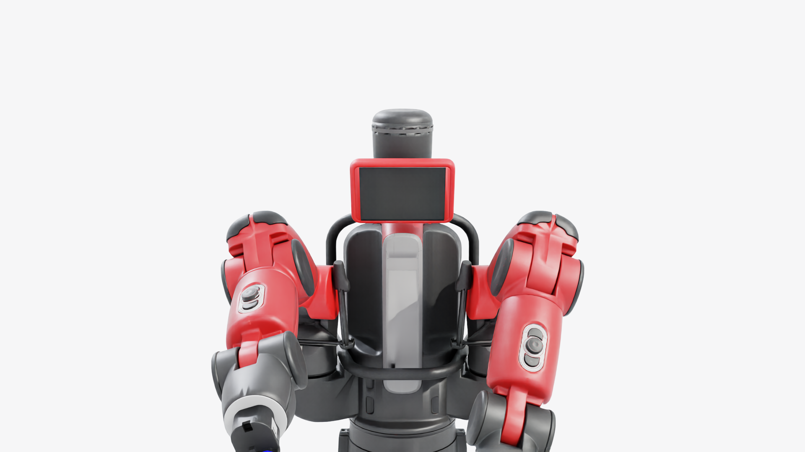

# baxter-py

[](LABS.md)
[](docs/reference/hardware_specifications.md)
[](pyproject.toml)
[](LICENSE)

A modern, standalone Python library and unified Command Line Interface (CLI) for the **Rethink Robotics Baxter** research robot.

`baxter-py` communicates natively via high-speed Rosbridge WebSockets (`ws://<ip>:9090`), removing the need for legacy ROS1 workstation installs, Python 2 environments, or catkin workspaces. It runs seamlessly on modern Python 3.10+ environments (including Ubuntu 24.04 and ARM64 / aarch64 architectures).

---

## 🎓 Baxter Teaching Labs & Engineering Curriculum (0 to Teleop)

Looking to teach or learn robotics with Baxter? Check out our complete **[11-Module Baxter Teaching Labs Curriculum](LABS.md)** with dedicated guides:

| Lab | Module Title & Focus | Guide |
| :-: | :--- | :-: |
| **0** | **Physical Architecture & Network Setup**: Unboxing, Link-Local `169.254.X.X`, Rosbridge port 9090 | [Lab 0 Guide](docs/labs/00_prerequisites_and_hardware.md) |
| **1** | **The E-Stop Lockout & Hardware Fix**: Rear DB15 Port, Optoisolators, Female Pinout Trap, Safety Bypass | [Lab 1 Guide](docs/labs/01_estop_and_safety_hardware_fix.md) |
| **2** | **Kinematic Limits & Arm Untwisting**: `e0`/`w0` Twist Limits, `e1` Hyperextension, SEA Torques, Zero-G | [Lab 2 Guide](docs/labs/02_kinematics_limits_and_arm_untwisting.md) |
| **3** | **Robot Initialization & Arm Tucking**: State Machine, Reset/Enable Handshake, Shipping Pose Tuck/Untuck | [Lab 3 Guide](docs/labs/03_robot_initialization_and_state_machine.md) |
| **4** | **Arm Control & Trajectory Filtering**: 7-DOF Kinematics, Low-Pass Trajectories, Joint Jogging, Poses | [Lab 4 Guide](docs/labs/04_arm_control_and_trajectory_filtering.md) |
| **5** | **Head Display, Emotions & Gaze**: 1024x600 LCD Screen, Vector Emotions, Custom Banners, Head Pan & Nod | [Lab 5 Guide](docs/labs/05_screen_display_and_head_interaction.md) |
| **6** | **Multimodal Vision & OpenCV Pipeline**: 3 CMOS Cameras, 2-Cam USB Bandwidth Limit, OpenCV Stream | [Lab 6 Guide](docs/labs/06_vision_and_camera_pipeline.md) |
| **7** | **AI Gesture Recognition & Interactive Games**: MediaPipe Hand Tracking, Boxing 2.0, Rock-Paper-Scissors | [Lab 7 Guide](docs/labs/07_interactive_ai_gaming_and_hri.md) |
| **8** | **NVIDIA Isaac Sim Digital Twin**: Real-to-Sim 60Hz Telemetry, Sim-to-Real UDP Sync, Photorealistic RTX | [Lab 8 Guide](docs/labs/08_digital_twin_and_isaac_sim.md) |
| **9** | **Capstone: 3D Spatial Vision Teleoperation**: Monocular 3D Metric $(X,Y,Z)$, Pinch Clutch, Sim-to-Real Mirror | [Lab 9 Guide](docs/labs/09_capstone_3d_spatial_vision_teleoperation.md) |
| **10**| **Hardware Diagnostics & Maintenance**: Sensor Tare, Zero-G Rubber Calibration, FTP `/var/log`, Error Codes | [Lab 10 Guide](docs/labs/10_hardware_diagnostics_and_maintenance.md) |

### Archived Technical Reference Guides:
- 📖 **[Hardware Specifications](docs/reference/hardware_specifications.md)**: Full physical dimensions, torques, electrical power, and degrees of freedom.
- 📖 **[DB15 Safety & User I/O Pinout](docs/reference/db15_user_io_pinout.md)**: Complete connector pinout, optoisolator specs, and wiring schematics.
- 📖 **[ROS Topics, Services & Messages](docs/reference/ros_topics_and_messages.md)**: Topic dictionary, service definitions, and message schemas.
- 📖 **[Kinematics & DH Parameters](docs/reference/kinematics_and_dh_parameters.md)**: Modified Denavit-Hartenberg parameters, transformations, and SEA compliance equations.

---

## Features

- **ROS-Agnostic WebSockets Client**: Direct asynchronous communication with Baxter's onboard Rosbridge server.
- **Unified Command Line Tool (`baxter`)**: Complete terminal tool to inspect status, enable/disable motors, jog joints, control display graphics, and trigger choreographies.
- **7-DOF Limb Motion & Filtering**: Smooth first-order low-pass trajectory execution with automated collision avoidance suppression.
- **Vector Screen Display & Facial Expressions**: Real-time 1024x600 LCD rendering with built-in emotional facial expressions (neutral, happy, focused, wink, boxing, disco, surprised, sleepy) and custom banners.
- **Camera Streaming & Vision**: Built-in decoder for head and hand camera streams with support for OpenCV and NumPy.
- **MediaPipe AI Boxing Partner**: Interactive computer vision sparring partner responding in real-time to human jabs, blocks, and hand gestures.
- **High-Level Choreography Engine**: Includes a 5-act orchestral symphony and a 124 BPM musical dance routine.

---

## Installation

Clone the repository and install the package in editable mode:

```bash
git clone https://github.com/RoboX2020/baxter-py.git
cd baxter-py
pip install -e .
```

To include interactive MediaPipe computer vision capabilities:

```bash
pip install -e ".[vision]"
```

---

## Command Line Interface (`baxter`)

Once installed, the `baxter` command is available in your shell:

### 1. State & Power Management
```bash
# Display system health, e-stop state, and all joint positions
baxter status

# Clear fault states and power on arm motors
baxter enable

# Power down arm motors
baxter disable

# Clear fault flags
baxter reset
```

### 2. Arm Motion & Poses
```bash
# Move arms to symmetrical operational neutral posture
baxter untuck

# Safely fold arms into compact shipping/storage pose
baxter tuck

# Execute predefined motion routines
baxter move wave
baxter move cheer
baxter move salute
baxter move reach
baxter move neutral

# Jog individual joints by degrees
# Syntax: baxter jog <left|right> <joint_name> <delta_deg>
baxter jog right s0 10.0
baxter jog left e1 -15.0
```

### 3. Screen Face & Graphics
```bash
# Change facial expression on Baxter's 1024x600 head screen
baxter face happy
baxter face boxing
baxter face disco
baxter face wink
baxter face focused

# Custom banner text
baxter face happy --text "READY FOR EXPERIMENT 1"

# Display custom image from disk
baxter face --image ./path/to/image.png
```

### 4. Head Pan & Nod
```bash
# Pan head (specify angle in degrees with --deg)
baxter head pan 30.0 --deg

# Perform head nod
baxter head nod
```

### 5. Cameras & Vision
```bash
# Capture a snapshot from the head camera to disk
baxter camera snapshot -o head_cam.jpg

# Open live OpenCV preview of the camera stream
baxter camera view
```

### 6. Interactive Vision & Gaming Arena
```bash
# Launch Baxter Interactive Arena (RPS, Boxer 2.0, Jedi Shadow Teleop, Fist-Bumps)
baxter play

# Launch standalone boxing sparring partner
baxter box --duration 60

# Run Daft Punk style 124 BPM musical dance party
baxter dance

# Run 5-act classical orchestral symphony choreography
baxter symphony
```

#### Arena Hotkeys:
* `[1]`: Arcade Reflex Boxer 2.0
* `[2]`: Rock-Paper-Scissors Showdown (press `SPACE` to count down & throw!)
* `[3]`: Jedi Shadow Teleoperation (intuitive 1:1 dual-arm mirroring with force push recoil)
  * `[m]`: Toggle horizontal flip
  * `[v]`: Toggle vertical flip
  * `[f]`: Toggle full flip (H+V)
* `[4]`: High-Five & Fist-Bump Partner
* `[m]`: Toggle Selfie Mirror Reflection mode (ON / OFF)
* `[q]` or `ESC`: Exit and return arms to neutral pose

### 7. NVIDIA Isaac Sim 3D Digital Twin & Bidirectional Sync
Launch an NVIDIA Isaac Sim 3D digital twin of Baxter running in parallel with the physical robot:

```bash
# Launch interactive 3D digital twin in Isaac Sim (auto-detects display)
baxter sim

# Launch in headless mode (background physics & telemetry)
baxter sim --headless

# Enable bidirectional sim-to-real commanding (sim controls physical Baxter with keyboard controls)
baxter sim --sim-to-real

# Render an instant photorealistic RTX viewport screenshot to disk
baxter sim --screenshot ./docs/screenshots/my_render.png --pose wave
```

#### Sim-to-Real Interactive Keyboard Controls:
When running `baxter sim --sim-to-real`, you can directly teleoperate Baxter inside Isaac Sim while physical Baxter mirrors every movement in real-time at 40 Hz:

| Key Command | Action |
| :--- | :--- |
| **`[1]`** | Neutral / Ready Stance (symmetrical operational pose) |
| **`[2]`** | Wave Gesture (right arm elevated, head turned) |
| **`[3]`** | Boxing Guard (arms forward, fists up) |
| **`[4]`** | Cheer / Victory Stance |
| **`[5]`** | Reach Forward |
| **`[0]`** | Tuck Arms (compact shipping pose) |
| **`[Tab]`** or **`[Space]`** | Toggle Active Arm (`RIGHT` $\leftrightarrow$ `LEFT`) |
| **`[q, w, e, r, t, y, u]`** | Select Joint: `[q]`=s0, `[w]`=s1, `[e]`=e0, `[r]`=e1, `[t]`=w0, `[y]`=w1, `[u]`=w2 |
| **`[+]`** / **`[-]`** or **`[k]`** / **`[j]`** | Jog selected joint by $\pm 5^\circ$ |
| **`[W]`** / **`[S]`** | Direct Shoulder Pitch (Arm UP / DOWN) |
| **`[A]`** / **`[D]`** | Direct Shoulder Pan (Arm OUTWARD / INWARD) |
| **`[R]`** / **`[F]`** | Direct Elbow Pitch (Elbow FLEX / EXTEND) |
| **`[[]`** / **`[]]`** | Pan Head Left / Right |
| **`[c]`** | Center Head Pan |
| **`[m]`** | Toggle Sim-to-Real synchronization ON / OFF |
| **`[h]`** | Display in-terminal hotkey help cheat sheet |
| **`[Esc]`** or **`[x]`** | Safely stop simulation |

#### Supported Screenshot Poses:
* `neutral`: Operational neutral posture with elbows flexed and head centered.
* `wave`: Right arm elevated in welcoming gesture with head tracking viewer.
* `boxing`: Dual-arm guard stance with forearms forward and fists up.
* `hero`: Full-body front-isometric showcase stance with pedestal.

#### Visual Gallery (RTX Viewport Renders):

| Neutral Stance | Waving Gesture |
| :---: | :---: |
|  |  |

| Boxing Guard | Hero Showcase |
| :---: | :---: |
|  |  |

#### Parallel Execution:
* **Real-to-Sim**: Physical Baxter encoder states (`/robot/joint_states`) continuously stream into Isaac Sim at 60+ FPS, faithfully mirroring physical motion, external forces, and human teleoperation.
* **Sim-to-Real & Parallel Commands**: All motion commands (`baxter move wave`, `baxter play`, `baxter dance`, etc.) automatically broadcast via low-latency UDP (`127.0.0.1:19888`) so both the real robot and Isaac Sim execute in lockstep synchronization.

---

### 8. 3D Fingertip Spatial Tracker & Sim-to-Real Teleoperation
Map your index fingertip in 3D metric space $(X, Y, Z)$ using a monocular camera and teleoperate Baxter in real-time across Isaac Sim and physical hardware:

```bash
# Launch live 3D fingertip tracking and Sim-to-Real teleoperation
baxter track

# Specify active arm and camera index
baxter track --arm left --camera 0
```

#### Features:
* **3D Metric Spatial Reconstruction**: Computes physical $(X, Y, Z)$ coordinates in meters relative to the camera using perspective projection and human anatomical knuckle scale.
* **Isometric 3D Workspace HUD**: Live visualizer rendering the 3D trajectory trail and real-time bounding volume.
* **Pinch-to-Engage & Continuous Modes**: Supports continuous tracking as well as pinch-to-engage clutch control (press `[e]` to toggle).
* **Arm Switching**: Press `[Tab]` or `[Space]` to toggle between Right and Left arm teleoperation.
* **Sim-to-Real Streaming**: Streams motion concurrently to NVIDIA Isaac Sim (`127.0.0.1:19888`) and physical Baxter motors.

### 9. Python API Usage

### Quickstart Example

```python
import asyncio
from baxter import Baxter

async def main():
    async with Baxter() as robot:
        # Check motor status and enable if needed
        state = await robot.get_state()
        if not state.get("enabled"):
            await robot.enable()

        # Untuck and display greeting face
        await robot.untuck(duration=3.5)
        await robot.display.show_emotion("happy", status_text="HELLO HUMAN!")

        # Perform friendly wave
        await robot.wave(cycles=3)

        # Jog single joint
        await robot.right_arm.jog("s0", delta_deg=10.0)

        # Return to neutral
        await robot.untuck(duration=3.0)

asyncio.run(main())
```

### Camera & MediaPipe Detection

```python
import asyncio
from baxter import Baxter
from baxter.vision import GestureDetector

async def stream_and_detect():
    detector = GestureDetector()
    async with Baxter() as robot:
        async for frame in robot.camera.stream("head_camera"):
            results = detector.detect(frame)
            for res in results:
                print(f"Hand gesture: {res['gesture']} (score: {res['score']:.2f})")

asyncio.run(stream_and_detect())
```

---

## Directory Structure

```text
baxter-py/
├── LABS.md              # Flagship 11-Module Baxter Teaching Curriculum
├── docs/
│   ├── labs/            # Detailed step-by-step guides for Labs 0 through 10
│   ├── reference/       # Archived hardware specs, DB15 pinout, ROS topics, kinematics
│   ├── assets/          # Schematics, hardware diagrams, camera feeds, teleop visualizers
│   └── screenshots/     # Photorealistic RTX Isaac Sim viewport renders
├── baxter/
│   ├── __init__.py      # Package export and version info
│   ├── client.py        # Core Baxter connection, WebSocket & parallel UDP broadcast
│   ├── limb.py          # Arm control, trajectory interpolation, and jogging
│   ├── head.py          # Head pan, nod, and gaze tracking
│   ├── display.py       # 1024x600 LCD renderer and vector emotions
│   ├── camera.py        # Camera subscriber and frame decoder
│   ├── poses.py         # Calibrated joint limits and pose libraries
│   ├── vision.py        # MediaPipe gesture detection and boxing AI logic
│   ├── arena.py         # Multi-game interactive arena (RPS, Boxer, Jedi, Bump)
│   ├── choreography.py  # Symphony and dance choreography routines
│   ├── sim.py           # NVIDIA Isaac Sim digital twin runner & bridge
│   ├── track.py         # 3D monocular spatial teleoperator & isometric HUD
│   └── cli.py           # Command line entry point ('baxter')
├── examples/            # Standalone runnable scripts
├── models/              # Pretrained gesture model and audio tracks
├── pyproject.toml       # Build configuration and dependencies
├── setup.py             # Setup script
└── README.md
```

---

## License

MIT License. See [LICENSE](LICENSE) for details.
