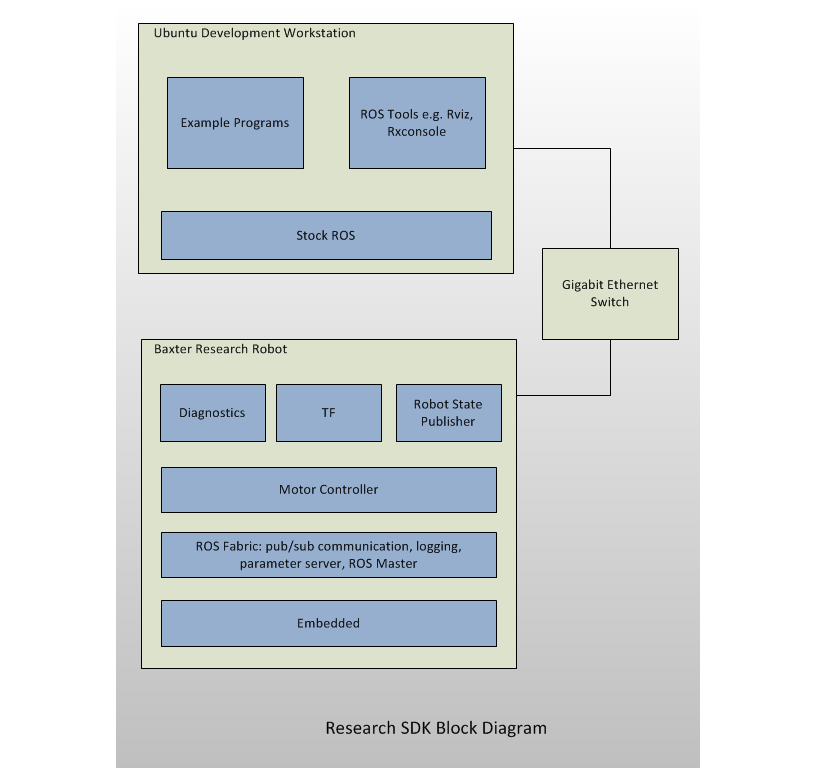
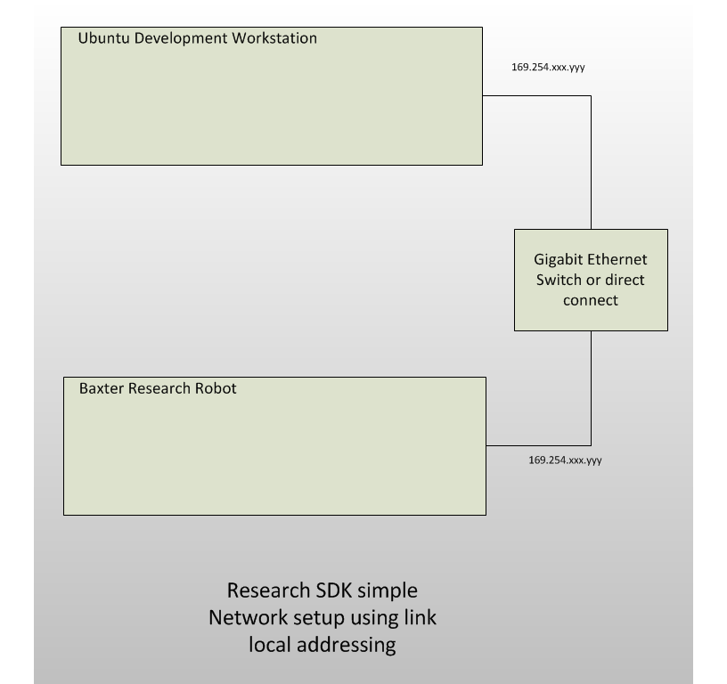

# Lab 0: Prerequisites, Physical Architecture & Network Setup

*Setting up Baxter from zero: mechanical mounting, AC power, link-local networking, and host connectivity.*

---

## 1. Objectives

By the end of this lab, you will:
1. Understand Baxter's physical safety architecture, component layout, and electrical specifications.
2. Connect your host workstation to Baxter via physical Ethernet using link-local addressing (`169.254.X.X`).
3. Verify network reachability with `ping` and discover Baxter's onboard Rosbridge WebSocket server (`port 9090`).
4. Install and verify the modern Python 3 `baxter-py` library on your workstation without needing legacy ROS 1 installations or Python 2 environments.

---

## 2. Hardware Architecture & Components

Baxter consists of the following key subsystems:



1. **Torso & Pedestal**: Houses the master computer (Intel Core i7 x86), power supplies, motor bus relays, rear power switch, and rear I/O connectors.
2. **Dual 7-DOF Articulated Limbs**: Driven by Series Elastic Actuators (SEAs) with integrated mechanical springs and joint torque sensing.
3. **Neck & Head Assembly**: Contains a 1024x600 color LCD display, head pan motor ($\pm 90^\circ$), head nod solenoid, 360° halo LED indicator, and 12-sensor ultrasonic sonar ring.
4. **End-Effectors & Cuffs**: Two quick-disconnect tool mounting plates, cuff navigators (rotary dial + two buttons), and cuff grip squeeze sensors (Zero-G mode).
5. **Integrated Cameras**: Three 1.2 megapixel CMOS sensors (Head, Left Wrist, Right Wrist).

---

## 3. Power-On Sequence

1. **Safety Clearance**: Verify that Baxter's dual arms have at least 1.5 meters of unobstructed clearance in all directions.
2. **AC Line Power**: Plug the standard IEC 3-prong power cord into a grounded 120V/240V AC wall receptacle.
3. **Main Power Switch**: Toggle the master rocker switch located at the rear bottom of Baxter's waist to the **ON (I)** position.
4. **Boot Sequence**:
   - The cooling fans will spin up to full speed and settle to an idle whisper.
   - The torso LED halo will illuminate yellow.
   - The internal x86 computer boots Ubuntu Linux (takes ~60 to 90 seconds).
   - Once the onboard software boots, the head LCD screen displays Baxter's sleeping or blank face, and the halo turns green or stays yellow (waiting for safety interlock).

---

## 4. Workstation Network Configuration

Baxter communicates over standard Ethernet using a direct cable or a local Gigabit switch.



### Option A: Direct Peer-to-Peer Link-Local (Recommended)
Connect an Ethernet cable directly from your laptop or workstation into the RJ45 port on Baxter's rear waist.

1. **Inspect Your Ethernet Interface Name**:
   ```bash
   ip -br addr
   # Example output: enx00e04c2e5460 or eth0
   ```

2. **Configure Link-Local (Automatic IPv4)**:
   Baxter automatically assigns itself an IPv4 link-local address in the `169.254.X.X / 16` subnet (e.g. `169.254.9.243`).
   Configure your workstation's Ethernet interface:
   ```bash
   # Using NetworkManager CLI (nmcli)
   nmcli con add type ethernet con-name baxter-link ifname <your_interface> ipv4.method link-local
   nmcli con up baxter-link
   ```
   Or manually assign a static address within the same link-local subnet:
   ```bash
   sudo ip addr add 169.254.254.8/16 dev <your_interface>
   sudo ip link set <your_interface> up
   ```

3. **Verify Connectivity**:
   Discover Baxter on the network using `arp-scan` or `avahi-browse`:
   ```bash
   # Scan the subnet for Baxter
   sudo arp-scan --interface=<your_interface> 169.254.0.0/16
   ```
   Ping Baxter (replace with Baxter's IP address or hostname `<serial_number>.local`):
   ```bash
   ping -c 3 169.254.9.243
   ```
   *Expected Output:*
   ```text
   64 bytes from 169.254.9.243: icmp_seq=1 ttl=64 time=0.452 ms
   64 bytes from 169.254.9.243: icmp_seq=2 ttl=64 time=0.388 ms
   3 packets transmitted, 3 received, 0% packet loss
   ```

4. **Verify Rosbridge WebSocket Port (9090)**:
   Baxter runs a Rosbridge WebSocket server that exposes the entire ROS master API over WebSockets:
   ```bash
   nc -zv 169.254.9.243 9090
   # Output: Connection to 169.254.9.243 9090 port [tcp/*] succeeded!
   ```

---

## 5. Installing `baxter-py` on Modern Linux (Python 3.10+)

Historically, using Baxter required Ubuntu 14.04 (Trusty), ROS Indigo, and Python 2.7. 
With `baxter-py`, you can run on modern Ubuntu 22.04 / 24.04 with Python 3.10+, or any Linux workstation.

1. **Clone the Repository**:
   ```bash
   git clone https://github.com/RoboX2020/baxter-py.git
   cd baxter-py
   ```

2. **Install in Editable Mode**:
   ```bash
   pip install -e ".[vision]"
   ```

3. **Test CLI Installation**:
   ```bash
   baxter --help
   ```

4. **Query System Status**:
   ```bash
   baxter status
   ```

If your terminal displays the robot status dictionary, your network connection and client library are successfully configured! In **Lab 1**, we will resolve the safety interlock and E-stop hardware lockout.
