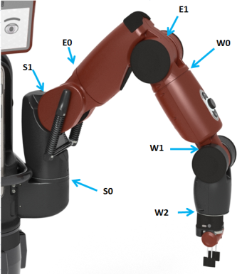

# Lab 2: Kinematic Limit Traps, SEA Gravity Faults & Safe Arm Untwisting

*Resolving joint limit lockouts, elbow hyperextension, Series Elastic Actuator (SEA) torque faults, and manual arm untwisting.*

---

## 1. Objectives

By the end of this lab, you will:
1. Understand why Baxter reports `error: True` and refuses to enable even after clearing the physical E-stop.
2. Identify the mechanical hard stops on Baxter's twist joints (`e0` and `w0`) and elbow hinge (`e1`).
3. Understand how Series Elastic Actuators (SEAs) detect gravity-induced joint torques while unpowered.
4. Manually untwist and reposition Baxter's limbs into the safe kinematic zone using cuff buttons and manual positioning.
5. Use live telemetry scripts to monitor joint angles in real time and verify that all limit faults have cleared.

---

## 2. The Symptom: E-Stop is Cleared, But Robot Still Refuses to Enable

After wiring the DB15 bypass plug in Lab 1, your state might look like this:
```bash
$ baxter status
Robot Status:
  enabled: False
  stopped: False       <-- E-stop is clear
  error: True          <-- But error is still True!
  estop_button: 0
  estop_source: 0
```
When you run `baxter enable`, Baxter attempts to reset, but the motor relays fail to click ON, or click ON for half a second and immediately shut off with:
```text
WARN (/realtime_loop,RobotStatePublisher.cpp:179) GlobalEnable requested, robot is still resetting
ERROR (/realtime_loop,Joint.cpp:337) Joint right_e0 tripped mechanical joint limit watchdog!
```

---

## 3. The Mechanics of the Twist Joints (`e0` & `w0`)

Each Baxter arm has 7 degrees of freedom:



Unlike humans, who have continuous range of motion through ball joints, Baxter's arms alternate between **Pitch joints (hinges)** and **Roll joints (rotary twists)**:
- **`s0`**: Shoulder Yaw / Pan
- **`s1`**: Shoulder Pitch (Arm up / down)
- **`e0`**: **Elbow Roll / Upper Arm Twist** (Rotation along bicep axis, like turning a screwdriver)
- **`e1`**: **Elbow Pitch** (Bends forearm toward upper arm)
- **`w0`**: **Wrist Roll / Forearm Twist** (Rotation of forearm around its long axis)
- **`w1`**: Wrist Pitch (Wrist flex up / down)
- **`w2`**: Wrist Roll (End-effector plate rotation)

### The Mechanical Limit Trap:
Joints **`e0`** and **`w0`** have a software limit of `[-3.054, +3.054]` radians ($\pm 175.0^\circ$).
Just beyond $175^\circ$ lies a **solid internal mechanical hard stop**.

When Baxter is moved, stored, or manually jostled while powered OFF, the forearm or upper arm is frequently twisted all the way around until it jams firmly against the $-174^\circ$ or $+174^\circ$ hard stop.
When Baxter boots, its internal position encoders read:
```text
right_e0: -3.037 rad (-174.0°)  [LIMIT TRIPPED]
right_w0: -3.059 rad (-175.3°)  [LIMIT TRIPPED]
right_e1: -0.062 rad (  -3.6°)  [HYPEREXTENDED]
```
Because the joints are jammed against their limits, Baxter's internal safety watchdog considers the robot in imminent danger of mechanical damage and **refuses to energize the motor bus relays**.

---

## 4. Series Elastic Actuators (SEA) & Gravity Torques

In addition to joint limits, Baxter uses **Series Elastic Actuators** (SEAs). Inside every joint, a planar spring measures the torque between the motor and the limb.

- If Baxter's arms are resting completely outstretched horizontally like planks, the cantilevered weight of the arm exerts up to $30\text{ N}\cdot\text{m}$ of pure gravity torque on the unpowered springs.
- If the arm is hyperextended backwards (`right_e1` at $-3.6^\circ$), the elbow joint cannot rotate forward under motor power without severe resistance.

---

## 5. The Physical Untwisting Procedure (Takes 10 Seconds)

To clear the error flags and allow the motors to enable, follow these manual steps:

```text
               +----------------------------------------+
               |  STEP 1: BEND THE ELBOW (e1)           |
               |  Gently flex elbow forward to ~45°-90° |
               +-------------------+--------------------+
                                   │
                                   ▼
               +----------------------------------------+
               |  STEP 2: UNTWIST THE FOREARM (w0)      |
               |  Rotate cuff so buttons face UPWARD    |
               +-------------------+--------------------+
                                   │
                                   ▼
               +----------------------------------------+
               |  STEP 3: UNTWIST THE UPPER ARM (e0)    |
               |  Rotate bicep into neutral center      |
               +-------------------+--------------------+
                                   │
                                   ▼
               +----------------------------------------+
               |  STEP 4: LIFT SLIGHTLY & RUN RESET     |
               |  Support wrist momentarily while       |
               |  running 'baxter enable'               |
               +----------------------------------------+
```

### Step 1: Bend the Elbow (`e1`) Forward
Look at both arms. If an arm is locked completely straight or bent backwards:
- Grab the forearm and bend the elbow forward into a relaxed L-shape ($45^\circ$ to $90^\circ$ angle).
- This takes `e1` from $-3.6^\circ$ up to $+45^\circ \dots +90^\circ$, cleanly clearing the hyperextension limit.

### Step 2: Untwist the Forearm (`w0`)
- Look at the end-effector cuff: the circular button and navigator dial should be facing naturally **UPWARD or FORWARD**, not twisted upside down or backwards against the stop.
- Rotate the forearm about a quarter to half turn until the joint angle moves from $-174^\circ$ toward $0^\circ \dots +90^\circ$.

### Step 3: Untwist the Upper Arm (`e0`)
- Rotate the bicep / elbow joint so that the elbow hinge is pointing outward/backward naturally.

> [!TIP]
> **Using the Zero-G Cuff Squeeze Sensor**:
> On each wrist cuff, there is a soft rubber squeeze ring. When Baxter's 12V logic power is ON, squeezing this rubber ring engages **Zero-Gravity Mode**, opening the motor brakes and allowing smooth, effortless manual positioning!

---

## 6. Live Joint Angle & Safety Monitoring Script

To observe the joint angles in real time while you untwist the arms, use this standalone monitoring utility:

```python
#!/usr/bin/env python3
"""Live Joint Twist & Safety Monitor for Baxter."""
import asyncio
from baxter import Baxter

async def monitor():
    async with Baxter() as robot:
        print("\n=== BAXTER ARM TWIST & SAFETY MONITOR ===")
        print("Watching right_e0, right_w0, right_e1. Rotate joints into safe range:\n")
        
        while True:
            state = await robot.get_state()
            joints = await robot.get_joint_positions()
            
            e0 = joints.get("right_e0", 0.0) * 180.0 / 3.14159
            w0 = joints.get("right_w0", 0.0) * 180.0 / 3.14159
            e1 = joints.get("right_e1", 0.0) * 180.0 / 3.14159
            
            e0_ok = -160.0 < e0 < 160.0
            w0_ok = -160.0 < w0 < 160.0
            e1_ok = e1 > 10.0
            
            st_e0 = "OK" if e0_ok else "JAMMED NEAR STOP"
            st_w0 = "OK" if w0_ok else "JAMMED NEAR STOP"
            st_e1 = "OK" if e1_ok else "HYPEREXTENDED"
            
            print(f"\r[STATUS] e0: {e0:6.1f}° ({st_e0:16}) | w0: {w0:6.1f}° ({st_w0:16}) | e1: {e1:5.1f}° ({st_e1:13}) | Error: {state.get('error')}", end="")
            
            if e0_ok and w0_ok and e1_ok and not state.get("enabled"):
                print("\n\n>>> ALL JOINTS IN SAFE ZONE! Attempting auto-enable...")
                await robot.enable()
                new_state = await robot.get_state()
                if new_state.get("enabled"):
                    print("************************************************")
                    print("*** SUCCESS! BAXTER MOTORS ARE FULLY ENABLED! ***")
                    print("************************************************")
                    break
            await asyncio.sleep(0.5)

if __name__ == "__main__":
    asyncio.run(monitor())
```

### The Telltale Sign of Success:
When `e0`, `w0`, and `e1` are safely positioned, running `baxter enable`:
1. You will hear a loud, satisfying **mechanical click (THUNK)** from the 48V contactor relays inside the lower torso.
2. The arm joints will instantly stiffen and resist external motion as the servo loops close.
3. Baxter's halo ring will transition to solid bright green.

In **Lab 3**, we will dive into the state machine, reset/enable pulse handshakes, and tucking/untucking operations.
