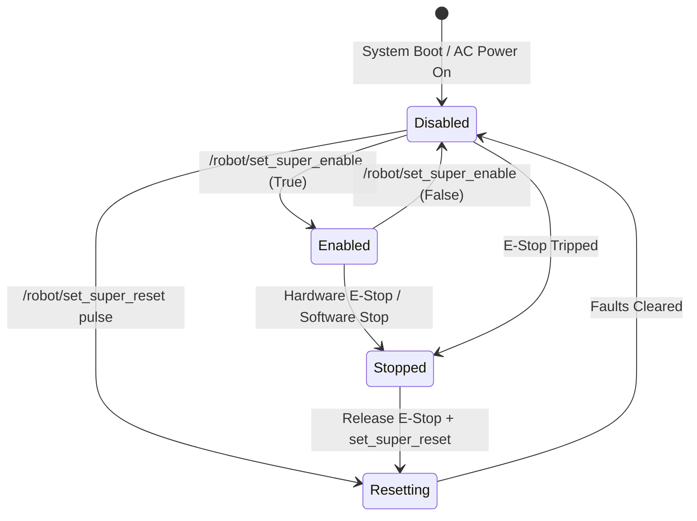
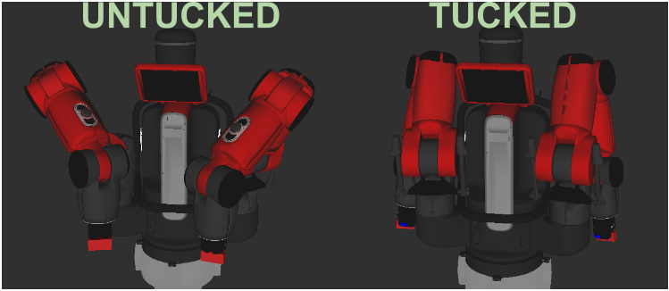

# Lab 3: Robot Initialization, State Machine & Arm Tucking

*Mastering Baxter's internal state machine, reset/enable pulse handshakes, and shipping pose tucking/untucking.*

---

## 1. Objectives

By the end of this lab, you will:
1. Deconstruct Baxter's internal state machine and lifecycle transitions (`DISABLED`, `RESETTING`, `ENABLED`, `STOPPED`).
2. Understand the exact topic handshake required to clear latching faults (`/robot/set_super_reset` $\rightarrow$ `/robot/set_super_enable`).
3. Power on and power down arm motor amplifiers via both the terminal CLI and Python async scripts.
4. Execute the automated arm tucking and untucking routines (`baxter tuck` and `baxter untuck`).
5. Understand the collision avoidance suppression mechanism required during tight-space maneuvers.

---

## 2. Baxter's State Machine Architecture

Baxter's top-level power controller runs an embedded state machine that coordinates 48V motor power relays, watchdog heartbeats, Series Elastic Actuator amplifiers, and collision models:



### State Flags in `baxter_core_msgs/AssemblyState`:
- **`enabled: False`, `stopped: False`, `error: False`**: Robot is in standby logic mode. Relay open; arm motors unpowered. Ready to enable.
- **`enabled: True`, `stopped: False`, `error: False`**: 48V relays closed; motor servo loops active at 1000 Hz. Robot is fully operational.
- **`stopped: True`**: Emergency stop asserted (hardware switch or software stop). Motors cut immediately.
- **`error: True`**: A hardware fault, joint limit violation, or amplifier overcurrent has occurred. Must be reset before enabling.

---

## 3. The Pulse Handshake: Why `enable` Alone Can Fail

If a joint has tripped a limit or an E-stop button was pressed and released, Baxter enters a **latched fault state** (`error: True`, `estop_button: 3`).

In this condition, simply commanding `enable(True)` is rejected by the controller:
```text
WARN (/realtime_loop,RobotStatePublisher.cpp:179) GlobalEnable requested, robot is still resetting
```

### The Required 3-Step Handshake:
To guarantee that the motor relays latch, you must execute the canonical reset sequence:

1. **Assert Global Disable**:
   Publish `data: False` to `/robot/set_super_enable` (`std_msgs/Bool`).
   *Wait 100 ms for motor controllers to de-energize.*
2. **Pulse Global Reset**:
   Publish an empty message to `/robot/set_super_reset` (`std_msgs/Empty`).
   *Wait 300–500 ms for joint amplifiers to run power-on self tests (POST) and clear fault registers.*
3. **Assert Global Enable**:
   Publish `data: True` to `/robot/set_super_enable` (`std_msgs/Bool`) at 10 Hz until `enabled == True` is confirmed on `/robot/state`.

`baxter-py` automates this entire handshake internally when you run `baxter enable` or call `await robot.enable()`.

---

## 4. State & Power Management CLI

Open your terminal and experiment with Baxter's power system:

```bash
# 1. Inspect current state and joint angles
baxter status

# 2. Reset any latching errors
baxter reset

# 3. Energize the 48V motor relays
baxter enable

# 4. De-energize the 48V motor relays (arms safely lower)
baxter disable
```

---

## 5. Tucking and Untucking Baxter's Arms

When Baxter is shipped or packed away, its arms are folded tightly into its chest in the **"Shipping Pose" (Tucked)**. 



### The Collision Avoidance Paradox:
In normal operation, Baxter runs an internal geometric collision model that actively stops the arms from colliding with each other or the torso.
However, in the **Shipping Pose**, the arms are folded within millimeters of the torso. If collision avoidance remained active, the robot would lock up and refuse to move out of the tucked pose!

### How `baxter-py` Solves This:
During `baxter untuck` and `baxter tuck`, the controller temporarily publishes heartbeat pulses to:
- `/robot/limb/left/suppress_collision_avoidance`
- `/robot/limb/right/suppress_collision_avoidance`

This allows the trajectory generator to unfold the arms safely along a deterministic trajectory without triggering collision halts.

---

## 6. Hands-On Exercise: Transitioning from Tucked to Neutral

### Step 1: Untuck Arms into Operational Stance
With Baxter enabled, run:
```bash
baxter untuck
```
*Observe Baxter's motion*:
1. The arms will smoothly unfold from the chest.
2. The elbows swing outward to clear the torso.
3. The arms settle into a symmetrical, forward-facing neutral stance ready for research tasks:
   - `s0: 0.0 rad (0°)`
   - `s1: -0.55 rad (-31.5°)`
   - `e0: 0.0 rad (0°)`
   - `e1: 1.25 rad (+71.6°)`
   - `w0: 0.0 rad (0°)`
   - `w1: 0.85 rad (+48.7°)`
   - `w2: 0.0 rad (0°)`

### Step 2: Tuck Arms for End-of-Day Storage
When laboratory experiments are complete:
```bash
baxter tuck
```
The arms will execute the inverse sequence, gently folding back into the torso before disabling the motor relays.

---

## 7. Python Automation Script

Here is an end-to-end Python script performing system health verification, enabling, untucking, and reporting status:

```python
#!/usr/bin/env python3
"""Lab 3: Python State Management and Untuck Exercise."""
import asyncio
from baxter import Baxter

async def main():
    async with Baxter() as robot:
        # Step 1: Query initial state
        state = await robot.get_state()
        print(f"Initial Robot State: enabled={state.get('enabled')}, stopped={state.get('stopped')}, error={state.get('error')}")
        
        # Step 2: Ensure robot is enabled
        if not state.get("enabled"):
            print("Energizing 48V motor relays...")
            await robot.enable()
            print("Motors successfully enabled!")

        # Step 3: Untuck arms into operational stance
        print("Executing smooth untuck routine...")
        await robot.untuck(duration=3.5)
        print("Arms are in operational neutral posture!")

        # Step 4: Display joint angles
        joints = await robot.get_joint_positions()
        print("\nLeft Arm Angles:")
        for j in ["left_s0", "left_s1", "left_e0", "left_e1", "left_w0", "left_w1", "left_w2"]:
            print(f"  {j}: {joints.get(j, 0.0):.3f} rad")

if __name__ == "__main__":
    asyncio.run(main())
```

In **Lab 4**, we will begin commanding individual joints, learning forward kinematics, and filtering trajectories to eliminate SEA spring vibrations.
