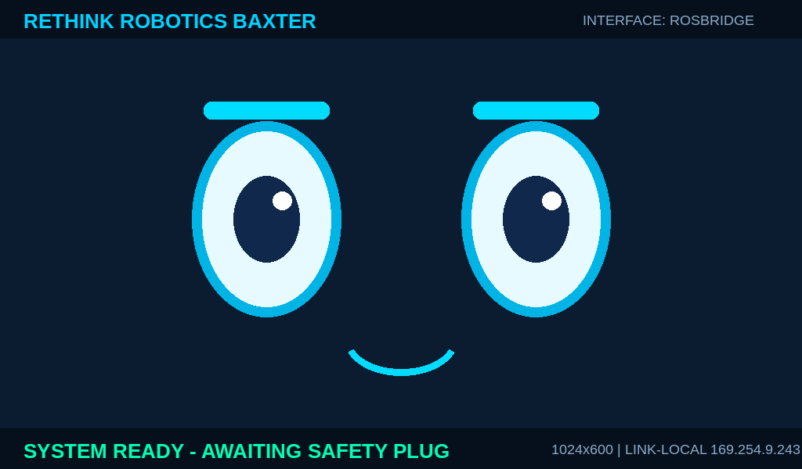

# Lab 5: Head Screen Display, Facial Emotions & Gaze Control

*Rendering 1024x600 vector graphics on Baxter's LCD face screen, programming social emotional expressions, and actuating head pan/nod.*

---

## 1. Objectives

By the end of this lab, you will:
1. Understand Baxter's 1024x600 LCD screen graphics pipeline via the `/robot/xdisplay` topic.
2. Render vector facial expressions using Python's Pillow (PIL) library without X11 desktop forwarding.
3. Switch between built-in emotional facial expressions (`happy`, `focused`, `wink`, `boxing`, `disco`, `sleepy`, `surprised`).
4. Overlay custom status banners and display arbitrary PNG/JPEG images on Baxter's face.
5. Actuate the head pan motor ($\pm 90^\circ$) and trigger the affirmative head nod mechanism.

---

## 2. The Head Screen Architecture

Baxter features a **1024 x 600 pixel color LCD monitor** mounted directly inside its head assembly.



### The Graphics Pipeline:
- The onboard screen is controlled by Baxter's internal display driver listening on the topic:
  ```text
  /robot/xdisplay (sensor_msgs/Image)
  ```
- Any standard raw image formatted as **RGB8 / BGR8** with dimensions **1024x600** published to this topic is immediately rasterized onto Baxter's screen at up to 30 Hz.
- `baxter-py` contains an integrated vector rendering engine that mathematically draws animated cartoon eyes, eyebrows, pupils, and mouth lines directly into memory, then compresses and streams the frame over WebSockets.

---

## 3. Changing Facial Expressions via CLI

`baxter-py` provides high-level commands to control Baxter's social persona:

```bash
# Happy smiling face
baxter face happy

# Focused / thinking face (eyebrows furrowed)
baxter face focused

# Playful winking face
baxter face wink

# Boxing / sparring game face (sports headband)
baxter face boxing

# Disco / sunglasses party face
baxter face disco

# Surprised / alert face (wide circular eyes)
baxter face surprised

# Sleepy / resting face (drooping eyelids)
baxter face sleepy
```

### Adding Custom Banner Text:
You can display status messages, team names, or telemetry across the top and bottom of Baxter's face:
```bash
baxter face happy --text "ROBOTICS LAB 101 - ACTIVE"
baxter face focused --text "RUNNING VISION SERVOING..."
```

### Displaying Custom Images from Disk:
To display university logos, diagrams, or camera feeds:
```bash
baxter face --image ./path/to/my_image.png
```
*(Images are automatically scaled and letterboxed to 1024x600 without distortion).*

---

## 4. Head Pan & Affirmative Nodding

Baxter's head assembly contains two distinct actuators:
1. **Head Pan Motor**: A direct rotary actuator providing $\pm 90^\circ$ ($\pm 1.571\text{ rad}$) of yaw rotation.
2. **Head Nod Mechanism**: A rapid solenoid/cam pulse that nods the screen up and down to indicate confirmation or understanding.

```bash
# Pan head 30 degrees to the right
baxter head pan -30.0 --deg

# Pan head 45 degrees to the left
baxter head pan 45.0 --deg

# Center head forward (0 degrees)
baxter head pan 0.0 --deg

# Trigger an affirmative nod
baxter head nod
```

---

## 5. Python API: Interactive Gaze & Social Response

Here is a Python script that coordinates facial expressions, head panning, and nodding into an interactive social greeting routine:

```python
#!/usr/bin/env python3
"""Lab 5: Interactive Social Head & Display Exercise."""
import asyncio
from baxter import Baxter

async def main():
    async with Baxter() as robot:
        state = await robot.get_state()
        if not state.get("enabled"):
            await robot.enable()

        print("1. Displaying welcoming smile...")
        await robot.display.show_emotion("happy", status_text="WELCOME TO THE LAB!")
        await asyncio.sleep(1.5)

        print("2. Looking left toward workstation...")
        await robot.head.pan(math_deg=45.0)
        await asyncio.sleep(1.0)

        print("3. Nodding in agreement...")
        await robot.head.nod()
        await robot.display.show_emotion("wink", status_text="I SEE YOU!")
        await asyncio.sleep(1.5)

        print("4. Looking right toward test arena...")
        await robot.head.pan(math_deg=-45.0)
        await robot.display.show_emotion("focused", status_text="ANALYZING TARGET...")
        await asyncio.sleep(1.5)

        print("5. Centering head and resetting to neutral...")
        await robot.head.pan(math_deg=0.0)
        await robot.display.show_emotion("neutral", status_text="READY")

if __name__ == "__main__":
    asyncio.run(main())
```

In **Lab 6**, we will tap into Baxter's optical sensors: streaming and processing video from the head and hand cameras.
