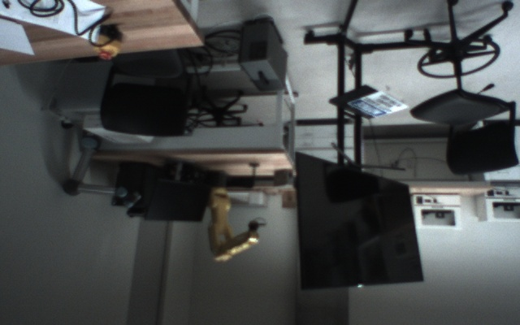

# Lab 6: Multimodal Vision, Embedded Cameras & OpenCV Pipeline

*Accessing Baxter's 3 onboard cameras, managing USB bus bandwidth constraints, and streaming frames into OpenCV.*

---

## 1. Objectives

By the end of this lab, you will:
1. Understand the physical placement and optical characteristics of Baxter's three cameras.
2. Master Baxter's USB bus bandwidth limitation (**maximum two cameras simultaneously**).
3. Switch camera streams dynamically between head and hand cameras.
4. Capture high-resolution snapshots to disk using the CLI.
5. Build an OpenCV computer vision pipeline for real-time edge detection and color thresholding.

---

## 2. Camera Hardware & Topology

Baxter is equipped with three Omnivision 1.2 Megapixel CMOS cameras:



1. **`head_camera`**: Located above the LCD screen on the head assembly. Offers an expansive birds-eye view of the workspace and approaching humans.
2. **`left_hand_camera`**: Integrated into the left tool cuff, pointing coaxially with the gripper mount.
3. **`right_hand_camera`**: Integrated into the right tool cuff, pointing coaxially with the gripper mount.

---

## 3. The 2-Camera USB Bandwidth Constraint

> [!IMPORTANT]
> **HARDWARE CONSTRAINT: MAXIMUM TWO CAMERAS CONCURRENTLY!**
> All three cameras connect back to the internal x86 torso computer over internal USB 2.0 root hubs. Due to USB 2.0 isochronous bandwidth limitations, Baxter's hardware **only supports streaming from TWO cameras at any given moment**.

### Default Boot Behavior:
Upon bootup, Baxter automatically opens:
1. `left_hand_camera` (320x200 @ 25 fps)
2. `right_hand_camera` (320x200 @ 25 fps)

If you attempt to open `head_camera` without first closing one of the hand cameras, the driver will reject the request with a bandwidth saturation error.
`baxter-py` handles this automatically: when you request `head_camera`, it gracefully suspends an idle wrist camera, opens the head camera, and restores the wrist camera when done.

---

## 4. Camera Resolution Modes

| Mode | Resolution (W x H) | Aspect Ratio | Primary Use Case |
| :---: | :---: | :---: | :--- |
| **0** | **1280 x 800** | 16:10 | Maximum detail; static inspection, AprilTags, OCR |
| **1** | **960 x 600** | 16:10 | High-quality visual tracking |
| **2** | **640 x 400** | 16:10 | Standard computer vision & deep learning models |
| **3** | **480 x 300** | 16:10 | Balanced speed / resolution |
| **4** | **384 x 240** | 16:10 | High-framerate visual servoing |
| **5** | **320 x 200** | 16:10 | Low bandwidth dual streaming |

---

## 5. Camera CLI Commands

Capture images and inspect streams directly from your terminal:

```bash
# Capture a snapshot from the head camera to disk
baxter camera snapshot -o head_cam.jpg

# Capture a snapshot from the right hand wrist camera
baxter camera snapshot --camera right_hand_camera -o wrist_cam.jpg

# Open a live OpenCV GUI preview window from the head camera
baxter camera view
```

---

## 6. Python OpenCV Computer Vision Pipeline

Here is a complete, runnable Python script that subscribes to the head camera stream, decodes frames into NumPy arrays, and runs real-time edge detection:

```python
#!/usr/bin/env python3
"""Lab 6: OpenCV Real-Time Vision Processing on Baxter Camera."""
import asyncio
import cv2
import numpy as np
from baxter import Baxter

async def process_stream():
    async with Baxter() as robot:
        print("Subscribing to Baxter head_camera stream...")
        
        async for frame_bgr in robot.camera.stream("head_camera", resolution=(640, 400)):
            # 1. Convert to Grayscale
            gray = cv2.cvtColor(frame_bgr, cv2.COLOR_BGR2GRAY)
            
            # 2. Gaussian Blur to reduce high-frequency noise
            blurred = cv2.GaussianBlur(gray, (5, 5), 0)
            
            # 3. Canny Edge Detection
            edges = cv2.Canny(blurred, 50, 150)
            
            # 4. Find Contours
            contours, _ = cv2.findContours(edges, cv2.RETR_EXTERNAL, cv2.CHAIN_APPROX_SIMPLE)
            
            # 5. Draw bounding boxes around large objects
            annotated = frame_bgr.copy()
            for cnt in contours:
                if cv2.contourArea(cnt) > 500:
                    x, y, w, h = cv2.boundingRect(cnt)
                    cv2.rectangle(annotated, (x, y), (x + w, y + h), (0, 255, 0), 2)
                    cv2.putText(annotated, "OBJECT", (x, y - 5), cv2.FONT_HERSHEY_SIMPLEX, 0.5, (0, 255, 0), 1)

            # Display side-by-side
            cv2.imshow("Baxter Head Camera - Raw vs Edges", np.hstack([annotated, cv2.cvtColor(edges, cv2.COLOR_GRAY2BGR)]))
            
            # Press 'q' to exit
            if cv2.waitKey(1) & 0xFF == ord('q'):
                break

    cv2.destroyAllWindows()

if __name__ == "__main__":
    asyncio.run(process_stream())
```

In **Lab 7**, we will link computer vision directly to real-time arm reflexes by integrating MediaPipe AI for interactive gaming, sparring, and gesture recognition.
