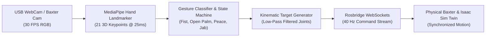

# Lab 7: AI Gesture Recognition & Interactive HRI Games

*Integrating Google MediaPipe, building an AI Boxing Sparring Partner, Rock-Paper-Scissors, and Human-Robot Interaction.*

---

## 1. Objectives

By the end of this lab, you will:
1. Integrate Google MediaPipe landmark detection with Baxter's high-speed motion generator.
2. Build a closed-loop reactive AI system that maps human hand gestures to real-time physical robot responses.
3. Run and analyze the **Arcade Reflex Boxer 2.0** (`baxter box`).
4. Play an interactive tournament of **Rock-Paper-Scissors** against Baxter (`baxter play`).
5. Execute calibrated musical choreographies with acoustic synchronization (`baxter dance` and `baxter symphony`).

---

## 2. Interactive Human-Robot Interaction Architecture

Human-Robot Interaction (HRI) requires ultra-low latency: if the delay between a human action and the robot's physical reaction exceeds 100 ms, the interaction feels disconnected and unnatural.



---

## 3. The Arcade Reflex Boxer 2.0 (`baxter box`)

`baxter box` transforms Baxter into a real-time reactive sparring partner:
- Baxter raises both arms into an authentic peek-a-boo boxing guard.
- Baxter's 1024x600 screen displays an animated boxing face with a red sports headband.
- When you throw a **Left Jab** (rapid forward motion of your fist toward the camera), Baxter instantly ducks and blocks with its right forearm.
- When you throw a **Right Cross**, Baxter parries with its left arm.
- If you drop your hands, Baxter throws a gentle, playful counter-jab!

### Launching the Boxer:
```bash
# Launch interactive boxing partner for a 60-second round
baxter box --duration 60
```

---

## 4. The Baxter Interactive Arena (`baxter play`)

The Interactive Arena provides a suite of multi-player HRI games:

```bash
baxter play
```

### Hotkey Game Modes:
- **`[1]` Arcade Reflex Boxer 2.0**: Full interactive sparring session.
- **`[2]` Rock-Paper-Scissors Showdown**:
  - Point your hand at the camera and press `[Space]`.
  - Baxter counts down: *"ROCK... PAPER... SCISSORS... SHOOT!"* by pumping its right arm up and down in synchrony with speech.
  - On "SHOOT!", Baxter randomly chooses Rock, Paper, or Scissors, detects your hand sign via MediaPipe, declares the winner on screen, and smiles or frowns!
- **`[3]` Jedi Shadow Teleoperation**:
  - Full dual-arm mirroring: raise your left arm, Baxter raises its left arm; push forward, Baxter pushes forward.
  - Press `[m]` to toggle selfie mirror reflection mode.
- **`[4]` High-Five & Fist-Bump Partner**:
  - Hold out your fist: Baxter extends its arm and meets your fist with a gentle touch, detecting contact using Series Elastic Actuator (SEA) deflection.

---

## 5. Musical Choreography: Dance & Symphony

To observe complex multi-joint coordinated trajectories synchronized to audio:

```bash
# Daft Punk style 124 BPM musical dance party with synchronized beats
baxter dance

# 5-act classical orchestral symphony choreography
baxter symphony
```

During the symphony, Baxter acts as the lead orchestral maestro, dynamically conducting invisible woodwinds, brass, strings, and timpani with expressive wrist and baton sweeps.

In **Lab 8**, we will bridge physical hardware into the virtual world by constructing an NVIDIA Isaac Sim photorealistic digital twin.
