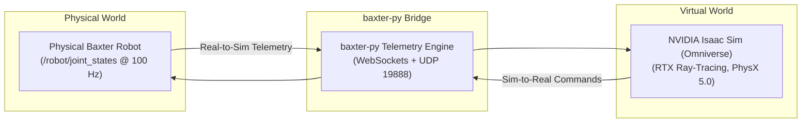
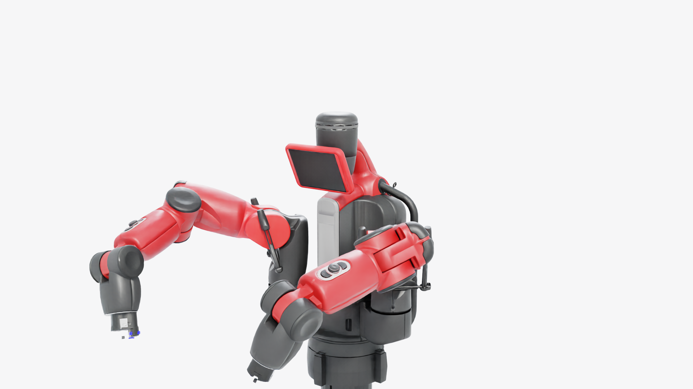
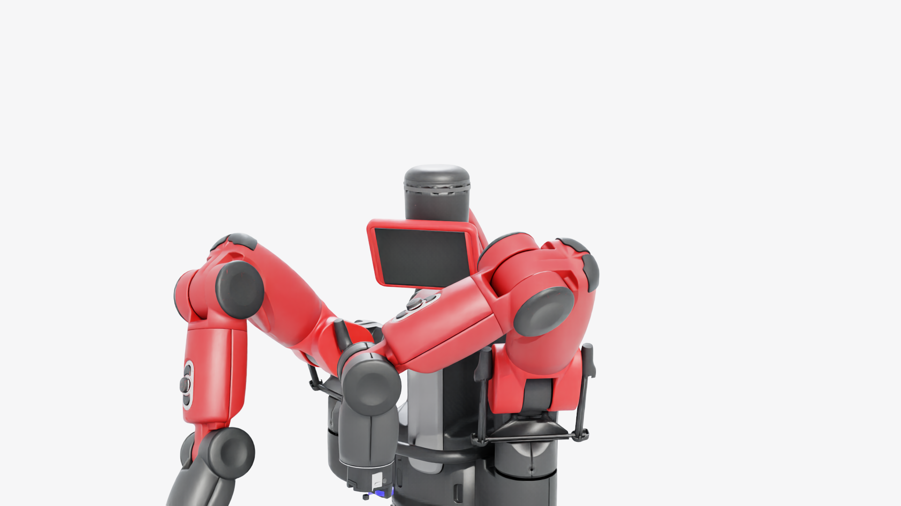
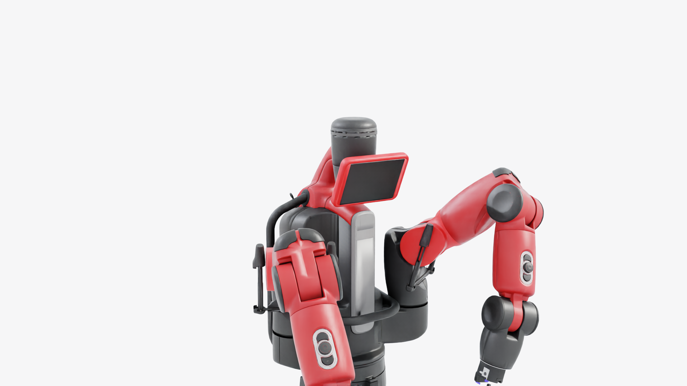
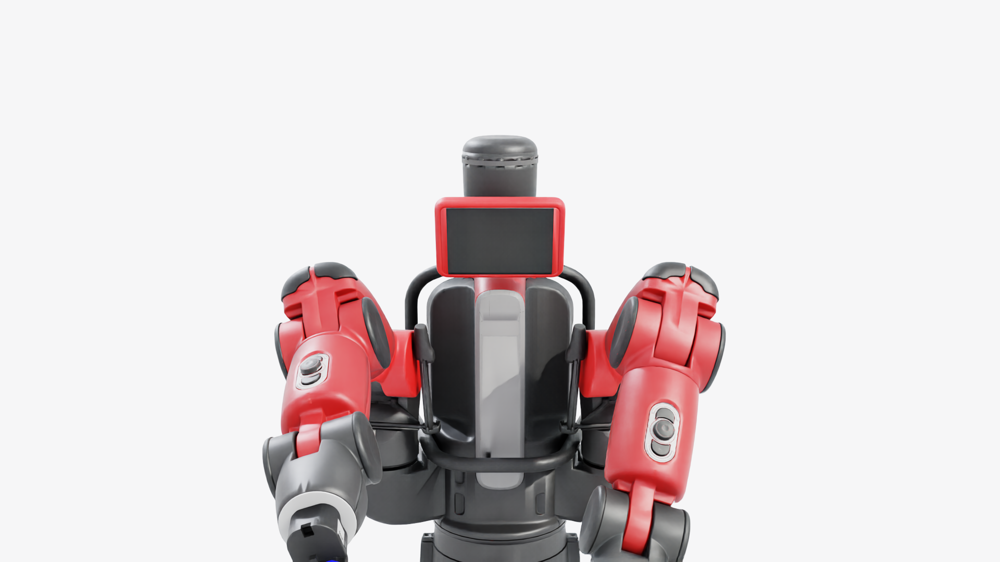

# Lab 8: NVIDIA Isaac Sim Digital Twin & Bidirectional Telemetry

*Connecting Baxter to NVIDIA Omniverse Isaac Sim, streaming 60 FPS joint states, and bidirectional Sim-to-Real control.*

---

## 1. Objectives

By the end of this lab, you will:
1. Understand the architecture of a real-time **Digital Twin** in robotics.
2. Launch an articulated USD simulation model of Baxter inside NVIDIA Isaac Sim.
3. Stream physical joint encoder telemetry into the virtual twin (**Real-to-Sim**).
4. Teleoperate the digital twin via interactive keyboard hotkeys and mirror movements onto the physical robot (**Sim-to-Real**).
5. Render photorealistic RTX ray-traced viewport snapshots to disk.

---

## 2. Digital Twin Architecture

A true digital twin operates bidirectionally:



1. **Real-to-Sim**: Physical Baxter encoder states (`/robot/joint_states`) continuously stream into Isaac Sim at 60+ FPS, faithfully mirroring physical motion, external forces, and human teleoperation.
2. **Sim-to-Real**: Commands issued inside the simulator are broadcast over UDP (`127.0.0.1:19888`), driving physical Baxter motors in lockstep.

---

## 3. Visual Gallery: RTX Viewport Renders

NVIDIA Isaac Sim provides real-time physically based lighting and ray tracing:

| Neutral Operational Stance | Welcoming Wave Gesture |
| :---: | :---: |
|  |  |

| Boxing Guard Pose | Hero Showcase Stance |
| :---: | :---: |
|  |  |

---

## 4. Running the Digital Twin

Launch the interactive simulator from your workstation:

```bash
# Launch interactive 3D digital twin (auto-detects display)
baxter sim

# Launch in headless mode (background physics & telemetry)
baxter sim --headless

# Enable bidirectional sim-to-real commanding
baxter sim --sim-to-real

# Render an instant photorealistic RTX viewport screenshot to disk
baxter sim --screenshot ./docs/screenshots/my_render.png --pose wave
```

---

## 5. Sim-to-Real Keyboard Teleoperation Controls

When running `baxter sim --sim-to-real`, you can directly teleoperate Baxter inside the simulation while physical Baxter mirrors every movement in real-time at 40 Hz:

| Key Command | Action |
| :--- | :--- |
| **`[1]`** | Neutral / Ready Stance (symmetrical operational pose) |
| **`[2]`** | Wave Gesture (right arm elevated, head turned) |
| **`[3]`** | Boxing Guard (arms forward, fists up) |
| **`[4]`** | Cheer / Victory Stance |
| **`[5]`** | Reach Forward |
| **`[0]`** | Tuck Arms (compact shipping pose) |
| **`[Tab]`** or **`[Space]`** | Toggle Active Arm (`RIGHT` $\leftrightarrow$ `LEFT`) |
| **`[q, w, e, r, t, y, u]`** | Select Joint: `[q]`=s0, `[w]`=s1, `[e]`=e0, `[r]`=e1, `[t]`=w0, `[y]`=w1, `[u]`=w2 |
| **`[+]`** / **`[-]`** or **`[k]`** / **`[j]`** | Jog selected joint by $\pm 5^\circ$ |
| **`[W]`** / **`[S]`** | Direct Shoulder Pitch (Arm UP / DOWN) |
| **`[A]`** / **`[D]`** | Direct Shoulder Pan (Arm OUTWARD / INWARD) |
| **`[R]`** / **`[F]`** | Direct Elbow Pitch (Elbow FLEX / EXTEND) |
| **`[[]`** / **`[]]`** | Pan Head Left / Right |
| **`[c]`** | Center Head Pan |
| **`[m]`** | Toggle Sim-to-Real synchronization ON / OFF |
| **`[h]`** | Display in-terminal hotkey help cheat sheet |
| **`[Esc]`** or **`[x]`** | Safely stop simulation |

In **Lab 9**, we reach the pinnacle of our curriculum: the **Capstone 3D Spatial Monocular Fingertip Vision Teleoperation Project**.
