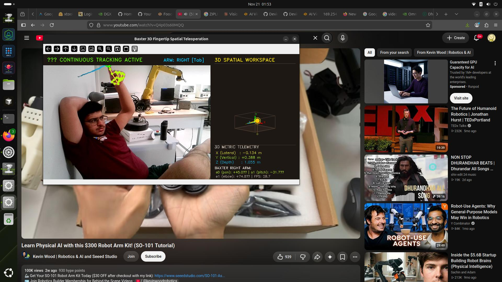
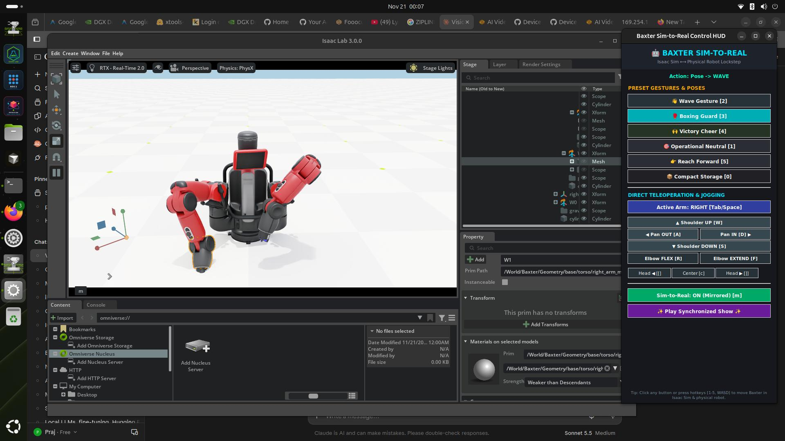
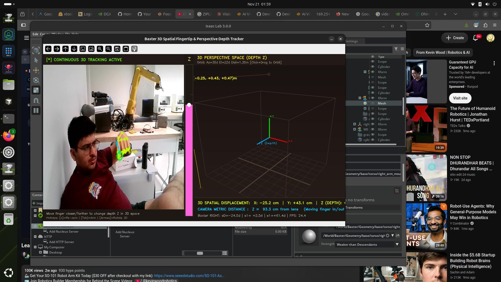

# Lab 9: Capstone: 3D Spatial Vision Teleoperation & Fingertip Tracking

*Monocular 3D spatial reconstruction, perspective projection, isometric HUD, and real-time Sim-to-Real dual-arm teleoperation.*

---

## 1. Objectives

By the end of this capstone lab, you will:
1. Reconstruct physical metric coordinates $(X, Y, Z)$ in meters from a standard 2D webcam using monocular perspective projection and human anatomical knuckle proportions.
2. Render an isometric 3D HUD visualizer with real-time trajectory trails and bounding volumes.
3. Implement a pinch-to-engage clutch mechanism to engage and disengage robot control effortlessly.
4. Teleoperate Baxter's 7-DOF arms in real-time using natural fingertip motions in free space.
5. Stream motion concurrently to physical Baxter hardware and the NVIDIA Isaac Sim digital twin.

---

## 2. Overview & Visual Gallery

The 3D Vision Teleoperation system allows an operator to control Baxter's arms simply by moving their index finger in front of a standard computer webcam.



| Desktop HUD Overlay | 3D Depth & Perspective Shadow Visualizer |
| :---: | :---: |
|  |  |

---

## 3. Mathematical Foundations: Monocular 3D Metric Reconstruction

Extracting 3D metric coordinates $(X, Y, Z)$ from a single 2D camera without LiDAR or depth sensors is an ill-posed inverse problem. We solve it by exploiting known **human anatomical proportions**.

### A. Estimating Depth ($Z$):
The human metacarpophalangeal (MCP) knuckle span (distance between index MCP and pinky MCP) is remarkably consistent across adult humans:
$$W_{\text{phys}} \approx 0.085\text{ meters } (8.5\text{ cm})$$

Using the pinhole camera projection model:
$$w_{\text{pixel}} = f \cdot \frac{W_{\text{phys}}}{Z}$$

Where $f$ is the focal length in pixels. We can solve directly for the metric depth $Z$:
$$Z = \frac{f \cdot W_{\text{phys}}}{w_{\text{pixel}}}$$

### B. Estimating Lateral Position ($X$) and Height ($Y$):
Once metric depth $Z$ is known:
$$X = \frac{(u - c_x) \cdot Z}{f}, \quad Y = \frac{(v - c_y) \cdot Z}{f}$$

Where $(u, v)$ is the pixel position of the index fingertip, and $(c_x, c_y)$ is the camera optical center.

---

## 4. The Clutch Mechanism (Pinch-to-Engage)

In industrial teleoperation, you need a way to reposition your hand without moving the robot (like lifting an optical mouse off a mousepad).

`baxter track` implements a **Pinch Clutch**:
- **Disengaged (Clutch Open)**: Move your hand into position. The HUD displays `CLUTCH: DISENGAGED (STANDBY)`. Baxter maintains its current hold pose.
- **Engaged (Clutch Closed)**: Pinch your index finger and thumb together (or press `[e]` to lock continuous tracking). The HUD turns green (`CLUTCH: ENGAGED`), and Baxter's arm instantly tracks your fingertip in 1:1 metric space!

---

## 5. Running the Teleoperator (`baxter track`)

Launch the tracking system from your workstation terminal:

```bash
# Launch live 3D fingertip tracking and Sim-to-Real teleoperation
baxter track

# Target the left arm instead of the right arm
baxter track --arm left

# Specify a secondary external webcam
baxter track --camera 1
```

### Hotkey Cheat Sheet:
- **`[Tab]` or `[Space]`**: Toggle Active Arm (`RIGHT` $\leftrightarrow$ `LEFT`).
- **`[e]`**: Toggle between **Pinch-to-Engage Mode** and **Continuous Tracking Mode**.
- **`[m]`**: Toggle Sim-to-Real mirroring (stream to physical hardware).
- **`[r]`**: Recenter workspace zero reference point.
- **`[q]` or `ESC`**: Safely disengage and return robot to neutral posture.

---

## 6. End-to-End Teleoperation Architecture

The teleoperator runs an asynchronous processing pipeline:
1. **Camera Ingestion (60 FPS)**: Captures frames from webcam or Baxter head camera.
2. **MediaPipe Tracking**: Computes 21 hand landmarks in 3D normalized coordinates.
3. **Metric Solver**: Computes $(X, Y, Z)$ position relative to the camera origin.
4. **Kinematic Mapping**: Translates $(X, Y, Z)$ offsets into 7-DOF Baxter joint commands:
   - Shoulder Pan (`s0`): Maps to lateral $X$ displacement.
   - Shoulder Pitch (`s1`): Maps to vertical $Y$ displacement.
   - Elbow Pitch (`e1`): Maps to metric depth $Z$ extension.
5. **Low-Pass Filter & Dispatch**: Filters joint values at 40 Hz and transmits packets over Rosbridge WebSockets and UDP (`127.0.0.1:19888`).

In **Lab 10**, we cover routine maintenance, zeroing calibration, sensor tare, and log retrieval to keep Baxter running smoothly.
