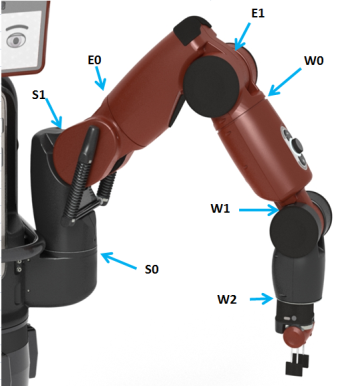

# Baxter Robot Hardware Specifications Reference

*Archived and compiled from official Rethink Robotics technical documentation and system manifests.*

---

## 1. Physical Specifications & Overview

The **Rethink Robotics Baxter Research Robot** is a dual-arm humanoid collaborative robot designed for research, industrial education, and human-robot interaction (HRI).

| Specification | Value / Description |
| :--- | :--- |
| **Total Height** | 37.0 in (940 mm) from pedestal mounting surface to top of head |
| **Total Width** | 31.0 in (787 mm) torso width; up to ~104 in (2.6 m) max arm span |
| **Total Weight** | ~165 lbs (75 kg) without pedestal; ~306 lbs (139 kg) with pedestal |
| **Payload Capacity** | 5.0 lbs (2.27 kg) rated continuous payload per arm (including gripper) |
| **Degrees of Freedom** | **15 Active DOF total**: • 7 DOF per arm (x2 = 14 DOF) • 1 DOF Head Pan (+ 1 Head Nod mechanism) |
| **Sensors** | • 3x 1.2 MP Color CMOS Cameras (Head, Left Hand, Right Hand) • 12x Ultrasonic Sonar Range Sensors (360° head ring) • 2x 3-axis Accelerometers per arm (forearm and wrist) • Series Elastic Actuator (SEA) torque sensors at all 14 arm joints |
| **Display** | 1024 x 600 color LCD display mounted on actuated neck |
| **Operating Temperature**| 10°C to 35°C (50°F to 95°F) |

---

## 2. Power & Electrical Requirements

| Component | Specification | Notes |
| :--- | :--- | :--- |
| **Input AC Power** | 100 – 240 VAC, 50/60 Hz | Auto-ranging universal power supply |
| **Peak Power Draw** | ~600 Watts | During heavy acceleration/motion on both arms |
| **Nominal Power Draw**| ~150 – 250 Watts | Idle / nominal research operations |
| **Internal DC Bus** | 48 VDC | Powers motor amplifier controllers (SEAs) |
| **Logic DC Supply** | +24 VDC, +12 VDC, +5 VDC | Powers onboard logic, sensors, and PC motherboard |
| **Safety Interlock** | DB15 Female Port (Rear Torso)| Opto-isolated 24V loop; cuts 48V motor bus relays |

---

## 3. Arm Joint Kinematics & Limits

Each 7-DOF arm is actuated by series elastic actuators (SEAs). Joints alternate between roll (twist) and pitch (flex) axes.

### Joint Limits & Motion Specs Table

| Joint Name | Anatomical Equivalent | Type | Range (Radians) | Range (Degrees) | Max Velocity | Max Torque |
| :--- | :--- | :--- | :--- | :--- | :--- | :--- |
| **`s0`** | Shoulder Pan | Twist / Yaw | `[-1.701, +1.701]` | `[-97.5°, +97.5°]` | 1.5 rad/s | 50.0 N·m |
| **`s1`** | Shoulder Pitch | Flex / Pitch | `[-2.147, +1.047]` | `[-123.0°, +60.0°]`| 1.5 rad/s | 50.0 N·m |
| **`e0`** | Elbow Roll | Arm Twist | `[-3.054, +3.054]` | `[-175.0°, +175.0°]`| 1.5 rad/s | 50.0 N·m |
| **`e1`** | Elbow Pitch | Elbow Flex | `[-0.050, +2.618]` | `[-2.9°, +150.0°]` | 1.5 rad/s | 50.0 N·m |
| **`w0`** | Wrist Roll | Forearm Twist | `[-3.059, +3.059]` | `[-175.3°, +175.3°]`| 4.0 rad/s | 15.0 N·m |
| **`w1`** | Wrist Pitch | Wrist Flex | `[-1.571, +2.094]` | `[-90.0°, +120.0°]`| 4.0 rad/s | 15.0 N·m |
| **`w2`** | Wrist Roll 2 | End-Effector Roll| `[-3.059, +3.059]` | `[-175.3°, +175.3°]`| 4.0 rad/s | 15.0 N·m |

> [!WARNING]
> Joints `e0` and `w0` have wide rotation ranges ($\pm 175^\circ$) but have mechanical hard-stops. If manually twisted against these stops while powered down, Baxter's boot check will trip `SEA_GLOBAL_ERROR` and refuse to latch the 48V motor power relays.

---

## 4. Head Actuation Specifications

| Actuator | Range | Max Velocity | Description |
| :--- | :--- | :--- | :--- |
| **Head Pan** | `[-1.571, +1.571]` rad (`[-90.0°, +90.0°]`) | 3.0 rad/s | Direct yaw control for gaze tracking |
| **Head Nod** | 0 to 1 (State impulse) | ~1.0 Hz | Solenoid/cam mechanism for affirmative nodding |

---

## 5. Camera Sensors & USB Architecture

Baxter contains three Omnivision CMOS sensor cameras:
1. **`head_camera`**: Located above the LCD screen on the head assembly.
2. **`left_hand_camera`**: Located in the left tool mounting cuff, looking coaxially with the end-effector.
3. **`right_hand_camera`**: Located in the right tool mounting cuff, looking coaxially with the end-effector.

### Camera Resolution Modes

| Mode Index | Resolution (W x H) | Max Framerate | Aspect Ratio | Use Case |
| :---: | :---: | :---: | :---: | :---: |
| 0 | **1280 x 800** | 30 fps | 16:10 | High-resolution object recognition / pose estimation |
| 1 | **960 x 600** | 30 fps | 16:10 | Mid-high resolution |
| 2 | **640 x 400** | 30 fps | 16:10 | Standard processing resolution |
| 3 | **480 x 300** | 30 fps | 16:10 | Low latency tracking |
| 4 | **384 x 240** | 30 fps | 16:10 | Fast visual servoing |
| 5 | **320 x 200** | 30 fps | 16:10 | Low bandwidth dual streaming |

> [!IMPORTANT]
> **Bandwidth Constraint**: All three cameras share internal USB 2.0 buses. Baxter's hardware **only supports a maximum of TWO cameras streaming concurrently**. Attempting to activate a third camera without disabling one of the active cameras results in a driver bandwidth error.

---

## 6. Onboard Computing Platform

Baxter contains an integrated x86 industrial PC inside its torso:
- **Processor**: Intel 3rd Gen Core i7 quad-core processor
- **RAM**: 4 GB DDR3
- **Storage**: 64 GB Solid State Drive (SSD)
- **Host OS**: Ubuntu Linux 12.04 LTS (Precise Pangolin) with Rethink Robotics RSDK Kernel
- **Network Interface**: 100/1000 Mbps Ethernet port on lower torso
- **Internal Bus Communication**: High-speed CAN bus interconnects linking joint motor controller boards to torso master computer.
